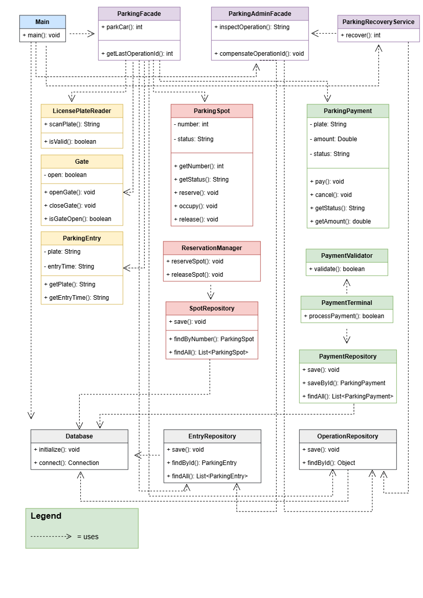

## Smart Parking Garage
## Overview
SmartParkingGarage is application that simulates an automated parking garage using the Facade Design Pattern.
It manages vehicle entry, parking space reservations, and payment processing. 
It also supports error handling, compensation, and recovery after application restarts.

## Project Structure
- Subsystem A - Gate Control
Classes: Gate, LicensePlateReader, ParkingEntry, EntryRepository
Responsible for license plate recognition, gate operations, and vehicle entry records.
- Subsystem B - Parking Reservation
Classes: ParkingSpot, SpotRepository, ReservationManager
Responsible for managing parking spaces and reservations.
- Subsystem C - Payment Processing
Classes: ParkingPayment, PaymentRepository, PaymentValidator, PaymentTerminal
Responsible for payment validation, processing, and payment records.
- Persistence - Database Management
Classes: Database, OperationRepository
Responsible for SQLite database connection, storing operation data, and tracking operation statuses.
- Facade - System Coordination
Classes: ParkingFacade, ParkingAdminFacade, ParkingRecoveryService
Responsible for coordinating subsystems, handling failures, manual compensation, and recovery after restarts.
- Main - Application Entry Point
Responsible for starting the application, initializing the database, and running the parking system.

## Principle of Least Knowledge
Before Facade: The client directly communicates with Gate, LicensePlateReader, ReservationManager, and PaymentTerminal. It must manage the execution order and handle errors.
After Facade: The client communicates with only one object.
The Facade reduces coupling and hides subsystem complexity.

## Facade vs. Adapter
SmartParkingGarage uses Facade because it needs to coordinate three subsystems: gate control - A, parking reservations - B, and payments - C.
Facade simplifies their interaction and handles failures. Adapter, instead, converts an incompatible interface into a compatible one.
Since our problem is workflow coordination, not interface incompatibility**, Facade is the better choice.

## Failure Handling
The application uses compensation to reverse previously completed steps when an error occurs.
Subsystem B failure: The vehicle entry from Subsystem A is reversed.
Subsystem C failure: The parking reservation from Subsystem B is released, followed by cancellation of the vehicle entry from Subsystem A.
Paid operations that require a refund must be handled separately.

## Database and Recovery
SQLite stores parking operations, entry records, parking spaces, payments, and their current statuses.
Each workflow has a unique operation ID.
The recovery service checks unfinished operations after an application restart and attempts to compensate them safely.

## UML Diagram

## Conclusion
SmartParkingGarage demonstrates how the Facade Design Pattern simplifies communication between independent subsystems. 
The project also illustrates state management, persistent storage, error compensation, and recovery.